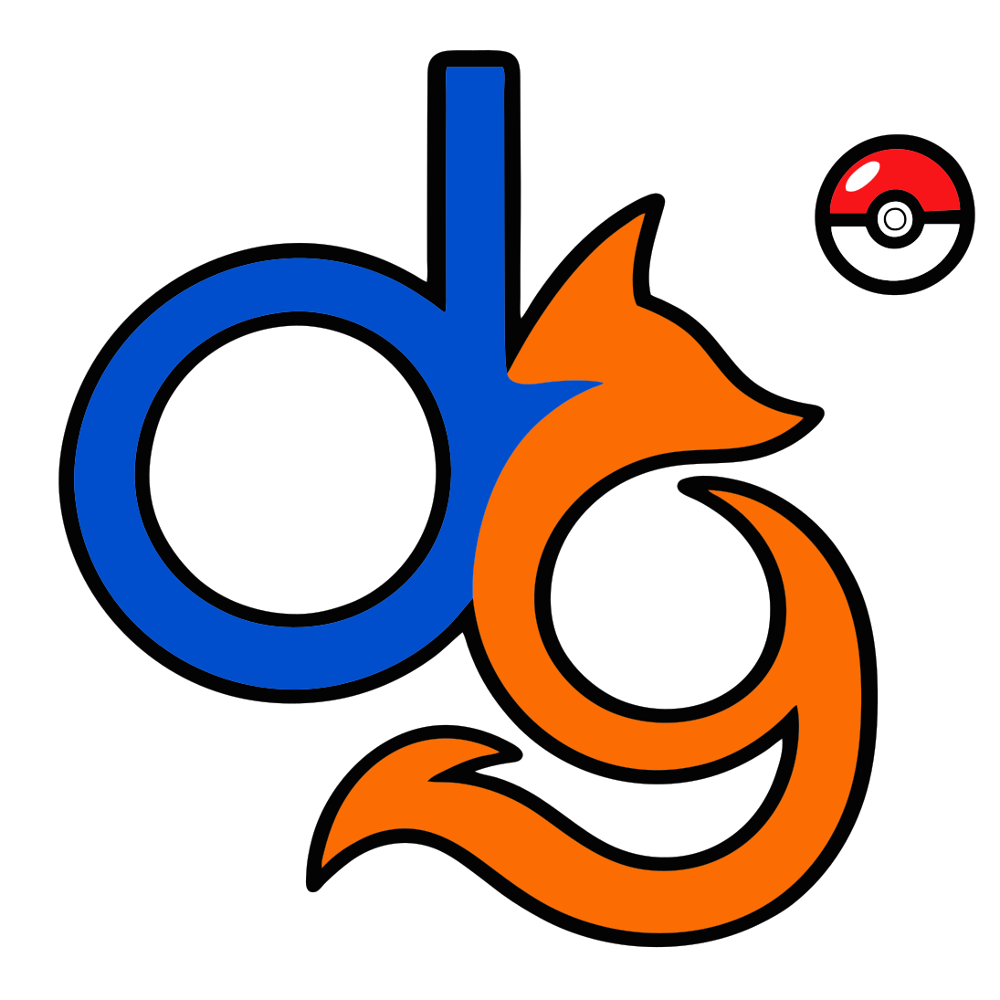

<div align="center">



# durgeshgowdac.

**A portfolio that tells time, changes planets, and has strong opinions about Appa.**

</div>

---

## Hi, I'm Durgesh 👋

I'm an AI/ML engineer in Bengaluru and an MTech graduate in Machine Intelligence from PES University. I like teaching machines to see, read and remember: computer vision, NLP and GenAI, preferably on messy real-world data rather than a tidy notebook.

A PDF resume can list that. It can't show how it felt, so I built a website with a small plot instead.

Under the hood: **Next.js 16, React 19 and TypeScript**, exported as a static site. No backend, no tracking, no drama.

## Where to find it

**Live site:** [durgeshgowdac.github.io](https://durgeshgowdac.github.io/)


Also deployed on

| Host | URL |
|---|---|
| Cloudflare | [portfolio.durgeshgowdac.workers.dev](https://portfolio.durgeshgowdac.workers.dev/) |
| Vercel | [durgeshgowdac.vercel.app](https://durgeshgowdac.vercel.app/) |
| Netlify | [durgeshgowdac.netlify.app](https://durgeshgowdac.netlify.app/) |
| Firebase | [durgeshgowdac.web.app](https://durgeshgowdac.web.app/) |
| Render | [durgeshgowdac.onrender.com](https://durgeshgowdac.onrender.com) |
| Surge | [durgeshgowdac.surge.sh](https://durgeshgowdac.surge.sh/) |
| Codeberg | [durgeshgowdac.codeberg.page](https://durgeshgowdac.codeberg.page/) |

## What makes this site a little different

Most portfolios are a list with good manners. This one is closer to a short film that happens to have a contact form.

### Two worlds, one story

- **It reads the clock.** From 7 pm to 6 am you land in **Space**; by day, **Nature**. One toggle overrules the clock, the site remembers your choice, and even the browser's address bar changes colour to match.
- **Every chapter has two names.** "The Trail" becomes "The Trajectory", "The Summit" becomes "Signal Received", and the 404 page tells a different joke depending on where you are standing.
- **A tiny hiker (or rocket) rides the scroll bar.** On wide screens it travels down the right edge as you read, each chapter is a stop you can click, and the rocket turns around when it reaches either end of the page, as any sensible rocket would. Phones get a slim progress bar instead.

### Drawn by hand, performed live

- **No stock art, no UI kit.** Mountains, rockets, foxes and speech bubbles are inline SVG, and the scenery is code rather than image files. The only pictures the site uses are the logo and the favicon (the images under `docs/` are generated from the code for the docs pages).
- **It has a cast.** My favourite worlds make cameo appearances, always drawn from scratch ([who's who](characters.md), [every drawing](illustrations.md), [every scene](scenes.md)):
  - **Avatar: The Last Airbender:** Aang, Appa, Momo, Sokka, Katara and Toph keep the Contact page company, and the whole gang (plus Zuko and Iroh) bends the elements under a hackathon deadline.
  - **Star Wars:** a very polite lightsaber duel, with a small green sidekick who has Things To Say.
  - **Harry Potter:** a broomstick, Hedwig and a Quidditch pitch.
  - **Gravity Falls:** Space mode's "Portal Under Pressure". A portal charges, Bill Cipher plays the deadline (his glowing eye is the moon, and it watches whoever is speaking), and Ford steps out precisely on time.
  - **Pokémon:** Ash strolls across the About page while a certain sleepy Snorlax holds the line.
  - **Wes Anderson:** the staging. Symmetrical, deadpan, one dry line per speech bubble, paced so you can finish reading before the next one arrives.
- **The gags are choreographed.** Sokka throws a boomerang, catches it on the way back, and Toph rules on the result. The lightsaber duel resets so you can watch it again, because some performances deserve an encore.
- **The hero takes turns.** The greeting types itself, the role rotates, and the "currently:" badge confesses what an ML engineer's day really involves, each in its own time rather than all at once.
- **The cursor has manners.** On desktop a soft ring trails your pointer and wraps itself around project cards and contact icons as you approach. Touch screens are spared.
- **It's polite about motion.** If your device asks for reduced motion, every scene settles into a calm still frame.

### Projects are stories, not bullet points

- **Cards flip.** The front is the pitch, the back is the tech stack. Search by name or technology, or filter by what a project is: AI / ML, Web Apps, Games & Graphics, Data Science or Tools.
- **Every project has its own case study**, with an "at a glance" strip of verifiable numbers before any prose, a sticky "Jump to" bar for the longer pages, and previous and next cards so nobody reaches a dead end.
- **Demos play on request.** Seven of the ten projects have a YouTube demo. Until you press play you get a thumbnail and nothing heavy loads, and the player is the privacy-friendly one.
- **The repo link stays honest.** At build time the site asks GitHub for each repository's main language, last update and stars, and quietly omits the line if GitHub is feeling shy.
- **Sharing takes one tap:** the native share sheet on phones, a copied link everywhere else.

### Details, because someone has to care about them

- **Getting in touch is never far.** "Get in touch" and copy-email buttons sit in the header on every page, and the email link opens a draft that has already begun.
- **Machines are welcome too.** Structured data, a sitemap, a robots file and a social preview image for every page, with preview deploys kept out of search results.
- **Quick and self-contained.** A static export with self-hosted fonts and icons, no third-party CDN, and no layout jump when the typography arrives.
- **Everyone is invited.** A skip link, keyboard-friendly controls, tap-to-reveal labels on touch screens, a tidy print stylesheet, and content that stays visible even with JavaScript switched off.

> **A note on the cast.** Fan tribute, strictly non-commercial. The characters belong to their creators and studios; the drawings are my own, made from scratch.

## A few things I've built

| Project | The pitch |
|---|---|
| **GlyphScholar** | A multimodal RAG system that reads a PDF properly and answers with a citation to the exact page, not a hallucination in a nice font. |
| **FoundYou** | Real-time multi-camera person re-identification: one global ID follows each person across cameras, occlusions and doorways. It grew out of my Indian Navy INICAI internship. |
| **MLXnarrator** | Gives a silent screen recording a voice, entirely offline on a Mac: local text-to-speech, automatic subtitles, finished MP4. |
| **RoleSense** | An AI resume screener that sorts resumes into 40+ job categories and matches them to a job description. (Hi, recruiters.) |
| **ArtAttack** | A satirical Unity game where you splatter paint across a pristine gallery. There's no security. The only thing stopping you is you. |
| **And more** | AVL tree animations for confused students, a Django attendance system, bot-detection EDA, a very messy loan dataset, and an apple that obeys Newton. |

## Hackathons: building under a countdown timer

Most of my best ideas arrive with a deadline attached. A few that shipped on time:

| Hackathon | What we built | Result |
|---|---|---|
| **CIDECODE Cyber Hackathon** (Karnataka Police CID × PES University, 2025) | **NoFakeAI**, a deepfake detection system | Team Lead · **6th of 341 teams**, Top 40 nationally |
| **TexPedition** (Epsilon × Hack2Skill, 2025) | **AdComply**, an advertisement compliance system | Team Lead · Finalist |
| **Smart India Hackathon** (Ministry of Education, 2025) | **FixMyNagara**, civic issue reporting and resolution | Team Lead · Selected |
| **Tata Elxsi TELIPORT Season 3** (2026) | **Shipbox**, a prompt-to-package sandbox that turns prompts into a tested, dockerized zip | Mentor · Team "Code bunnies" cleared 2 rounds |

## A bit more about me

- **Education:**
  - **MTech, Machine Intelligence** (PES University, 2024–2026): **CGPA 9.41**.
  - **BTech, Computer Engineering (Data Science)** (Presidency University, Bangalore, 2019–2023): **CGPA 9.19**.
  - **Prof. CNR Rao Scholar:** a merit distinction awarded to the top 20% of students by SGPA, with a Merit Certificate and a 40% tuition-fee refund. Named for India's own Bharat Ratna chemist, which is not a bad namesake to share a merit list with.
- **Experience:**
  - **Indian Navy, INICAI:** AI/ML engineer intern building real-time multi-camera person tracking and re-identification.
  - **ISRO ISTRAC:** project intern wiring Whisper and a fine-tuned RoBERTa into mission-control voice and text commands, then building a search engine that got scientists to satellite telemetry about 10 times faster.
  - **Simple Icons:** open-source contributor, adding brand icons through the usual GitHub PRs.
- **Toolbox:** Python, C++ and Java; PyTorch, TensorFlow, Hugging Face, OpenCV, FAISS and YOLO; Gemini, Vertex AI and multimodal RAG; Docker, GCP, FastAPI and a healthy collection of databases.
- **Always learning:** a LeetCode habit, a Hyperskill streak that has outlasted several New Year's resolutions, and a Google Cloud Skills Boost Diamond League badge collection that began in 2021 and shows no sign of retiring.
- **Conferences I've attended:** SMOPS-2023 (spacecraft mission operations, during my ISRO internship), Guidewire DEVSummit 2025 and OpenAI DevDay Exchange Bengaluru 2026.
- **Away from the keyboard:** Taekwondo, cricket and volleyball. Drilling fundamentals until they're boring, watching patiently, and playing as a team where nobody wins a rally alone: surprisingly good debugging training.
- **Who I look up to:** Aaron Swartz, Kevin Mitnick, Steve Jobs, Alan Turing, Geoffrey Hinton, Isaac Newton, Nikola Tesla and Marie Curie. The About page explains why, and yes, Newton is the entire reason the apple project exists.

The About page has the full, mildly overshared edition.

## Run it

```bash
npm install
npm run dev     # http://localhost:3000
```

Adding a project is a one-entry job: describe it in `app/lib/projects.ts` and the card, the case-study page and the social preview assemble themselves.

## Regenerating the illustration docs

Every drawing is code (`app/components/scenery/illustrations/`). One tool turns that code into the three pages below and every image on them, so nothing is drawn by hand twice:

- **[characters.md](characters.md):** the cast, with a contact sheet per group, where each character appears and what they say.
- **[illustrations.md](illustrations.md):** the illustration library, every part in both themes.
- **[scenes.md](scenes.md):** the strips and page backdrops, photographed from the real components, plus close-up cutaways.

The images are in `art/`: `parts/<light|dark>/` (every part as SVG, plus 1024 px PNGs of the characters), `sheets/`, `characters/` (contact sheets) and `scenes/`.

```bash
npm install                               # once; the components need react and react-dom
npm run illustrations                     # everything (about 2 minutes)
bash tools/build.sh parts sheets docs # or name the steps: parts, sheets, scenes, docs
bash tools/build.sh scenes --no-bg    # scene strips without their sky
```

The first run creates a Python virtualenv in `.venv/` at the repo root, installs Playwright into it and downloads Chromium (a few hundred MB, one time). Delete `.venv/` any time to start fresh.

The build is driven by one manifest, all in `tools/`:

1. **`registry.tsx`** (bundled with esbuild) lists every part, cutaway and scene, and server-renders each to SVG markup.
2. **`render.py`** drops each part into Chromium with the site's real stylesheet and theme switch, crops it tightly, bakes every `var()`, `color-mix()` and class into plain values, strips the animation and saves `art/parts/<light|dark>/<Id>.svg`, plus 1024 px PNGs for the characters. It then composes the gallery sheets and one contact sheet per character group from those same exports, and photographs each scene with the site's own stylesheet.
3. **`build_art.py`** writes the three pages and fails if they drift from the code (a scene used on a page with no entry, a character pointing at a missing part, a part missing in either theme).

Things worth knowing:

- **Adding a part:** put its name in a group in `tools/registry.tsx`.
- **Adding a character:** add the part, then an entry in `tools/characters.json` (`part` is the part's id; the fields are where they appear and what they say).
- **Adding a scene:** one entry in `SCENES` in `tools/registry.tsx`.
- **Nature pieces use the day palette and Space pieces the night palette.** Both are read from `app/styles/base.css` (and `element-marks.css` for the Star Wars crests).
- **The look of the sheets** is set by the numbers near the bottom of `tools/render.py` (cell size, columns, maximum scale).
- **The exports are for docs and sharing.** The site never loads them, so "the scenery is code rather than image files" still holds.


These are mirrors of the same build, kept for redundancy. The GitHub Pages address is the canonical one.

## Say hello

I'm open to AI Engineer, ML Engineer, Applied AI, NLP, Computer Vision and GenAI roles, and always happy to talk shop about anything with a camera feed, a corpus or a stubborn edge case.

- **GitHub:** [github.com/durgeshgowdac](https://github.com/durgeshgowdac)
- **LinkedIn:** [linkedin.com/in/durgeshgowdac](https://www.linkedin.com/in/durgeshgowdac/)
- **itch.io** (home of the questionable games): [durgeshgowdac.itch.io](https://durgeshgowdac.itch.io/)
- **YouTube** (project demos, with commentary): [youtube.com/@durgenious](https://www.youtube.com/@durgenious)

<div align="center">

---


*"The Revolution will be A/B tested."* — Aaron Swartz, who gets the last word in the footer too.

</div>