# Illustrations

*The art, in three pages:* [Characters](characters.md) · **Illustrations** · [Scenes](scenes.md)

Every illustration on the site, in one place. There are no stock images and no icon packs: each of these is an inline SVG component, hand-drawn in code and rendered here straight from the source, so this page cannot drift from the website.

The site has two worlds, so most pieces appear twice: once in **Nature** (light) and once in **Space** (dark). Characters appear only in the world they live in. Nobody is to scale; a fox and a rocket have agreed to share a frame.

The compositions you meet while scrolling (the strips, the backdrops, the page scenes) live in **[scenes.md](scenes.md)**; who is who, and what they say, is in **[characters.md](characters.md)**. This page is the parts they are built from.

**Jump to:** [The Nature world](#the-nature-world) · [The Space world](#the-space-world) · [Card and chapter marks](#card-and-chapter-marks) · [Avatar: The Last Airbender](#avatar-the-last-airbender) · [Pokémon](#pokémon) · [Star Wars](#star-wars) · [Gravity Falls](#gravity-falls) · [Harry Potter](#harry-potter) · [Element marks](#element-marks) · [Scenes](scenes.md)

## The Nature world

Trees, critters and campsite things. The trail, drawn one outline at a time.

**Nature mode (light)**

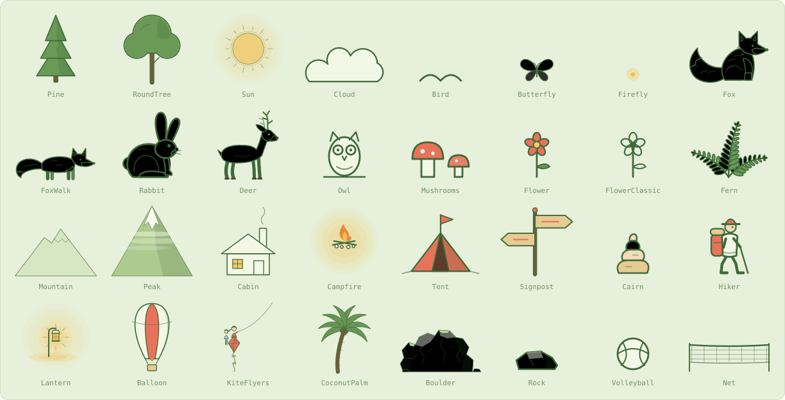

**Space mode (dark)**

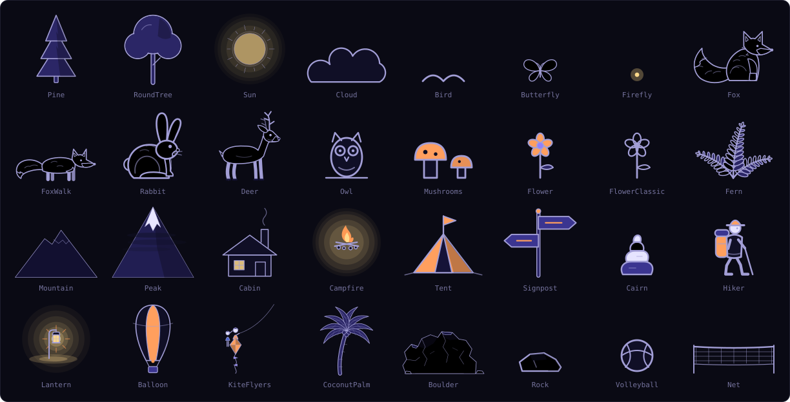

32 parts, as individual files

[`Pine`](art/parts/light/Pine.svg), [`RoundTree`](art/parts/light/RoundTree.svg), [`Sun`](art/parts/light/Sun.svg), [`Cloud`](art/parts/light/Cloud.svg), [`Bird`](art/parts/light/Bird.svg), [`Butterfly`](art/parts/light/Butterfly.svg), [`Firefly`](art/parts/light/Firefly.svg), [`Fox`](art/parts/light/Fox.svg), [`FoxWalk`](art/parts/light/FoxWalk.svg), [`Rabbit`](art/parts/light/Rabbit.svg), [`Deer`](art/parts/light/Deer.svg), [`Owl`](art/parts/light/Owl.svg), [`Mushrooms`](art/parts/light/Mushrooms.svg), [`Flower`](art/parts/light/Flower.svg), [`FlowerClassic`](art/parts/light/FlowerClassic.svg), [`Fern`](art/parts/light/Fern.svg), [`Mountain`](art/parts/light/Mountain.svg), [`Peak`](art/parts/light/Peak.svg), [`Cabin`](art/parts/light/Cabin.svg), [`Campfire`](art/parts/light/Campfire.svg), [`Tent`](art/parts/light/Tent.svg), [`Signpost`](art/parts/light/Signpost.svg), [`Cairn`](art/parts/light/Cairn.svg), [`Hiker`](art/parts/light/Hiker.svg), [`Lantern`](art/parts/light/Lantern.svg), [`Balloon`](art/parts/light/Balloon.svg), [`KiteFlyers`](art/parts/light/KiteFlyers.svg), [`CoconutPalm`](art/parts/light/CoconutPalm.svg), [`Boulder`](art/parts/light/Boulder.svg), [`Rock`](art/parts/light/Rock.svg), [`Volleyball`](art/parts/light/Volleyball.svg), [`Net`](art/parts/light/Net.svg)

Each part also exists in both themes: `art/parts/light/` and `art/parts/dark/`.

## The Space world

Rockets, rovers and rocks. Launch pad to the far side of the moon.

**Space mode (dark)**

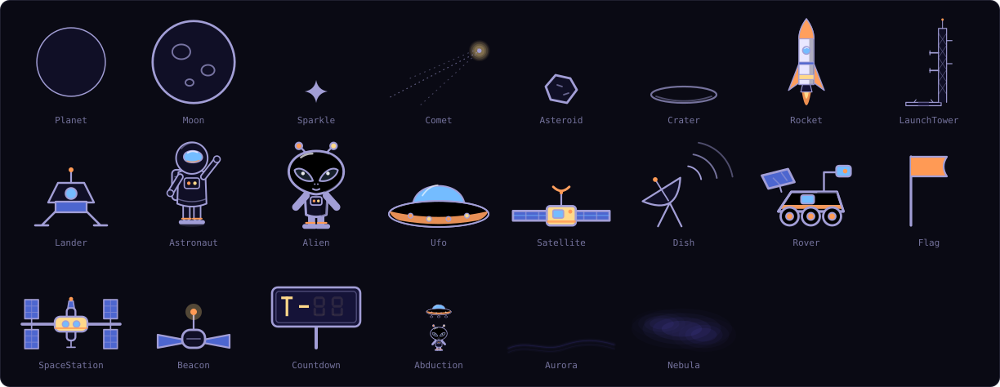

**Nature mode (light)**

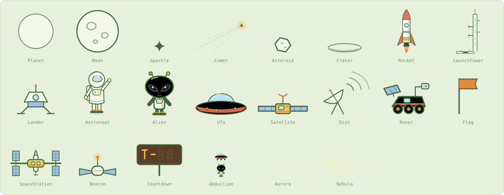

22 parts, as individual files

[`Planet`](art/parts/dark/Planet.svg), [`Moon`](art/parts/dark/Moon.svg), [`Sparkle`](art/parts/dark/Sparkle.svg), [`Comet`](art/parts/dark/Comet.svg), [`Asteroid`](art/parts/dark/Asteroid.svg), [`Crater`](art/parts/dark/Crater.svg), [`Rocket`](art/parts/dark/Rocket.svg), [`LaunchTower`](art/parts/dark/LaunchTower.svg), [`Lander`](art/parts/dark/Lander.svg), [`Astronaut`](art/parts/dark/Astronaut.svg), [`Alien`](art/parts/dark/Alien.svg), [`Ufo`](art/parts/dark/Ufo.svg), [`Satellite`](art/parts/dark/Satellite.svg), [`Dish`](art/parts/dark/Dish.svg), [`Rover`](art/parts/dark/Rover.svg), [`Flag`](art/parts/dark/Flag.svg), [`SpaceStation`](art/parts/dark/SpaceStation.svg), [`Beacon`](art/parts/dark/Beacon.svg), [`Countdown`](art/parts/dark/Countdown.svg), [`Abduction`](art/parts/dark/Abduction.svg), [`Aurora`](art/parts/dark/Aurora.svg), [`Nebula`](art/parts/dark/Nebula.svg)

Each part also exists in both themes: `art/parts/light/` and `art/parts/dark/`.

## Card and chapter marks

The small emblems that sit on cards and section headings.

**Nature mode (light)**

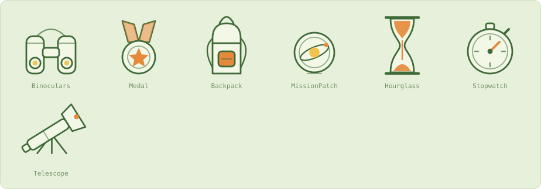

**Space mode (dark)**

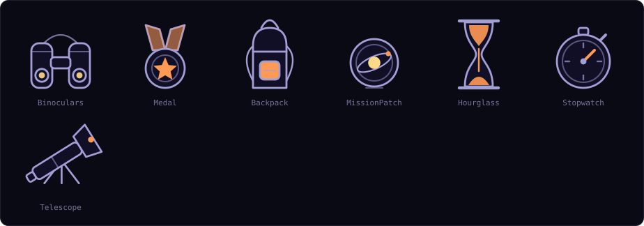

7 parts, as individual files

[`Binoculars`](art/parts/light/Binoculars.svg), [`Medal`](art/parts/light/Medal.svg), [`Backpack`](art/parts/light/Backpack.svg), [`MissionPatch`](art/parts/light/MissionPatch.svg), [`Hourglass`](art/parts/light/Hourglass.svg), [`Stopwatch`](art/parts/light/Stopwatch.svg), [`Telescope`](art/parts/light/Telescope.svg)

Each part also exists in both themes: `art/parts/light/` and `art/parts/dark/`.

## Avatar: The Last Airbender

Nature mode. Everyone is drawn from scratch and nobody is to scale.

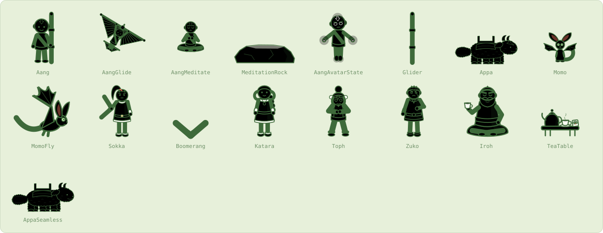

17 parts, as individual files

[`Aang`](art/parts/light/Aang.svg), [`AangGlide`](art/parts/light/AangGlide.svg), [`AangMeditate`](art/parts/light/AangMeditate.svg), [`MeditationRock`](art/parts/light/MeditationRock.svg), [`AangAvatarState`](art/parts/light/AangAvatarState.svg), [`Glider`](art/parts/light/Glider.svg), [`Appa`](art/parts/light/Appa.svg), [`Momo`](art/parts/light/Momo.svg), [`MomoFly`](art/parts/light/MomoFly.svg), [`Sokka`](art/parts/light/Sokka.svg), [`Boomerang`](art/parts/light/Boomerang.svg), [`Katara`](art/parts/light/Katara.svg), [`Toph`](art/parts/light/Toph.svg), [`Zuko`](art/parts/light/Zuko.svg), [`Iroh`](art/parts/light/Iroh.svg), [`TeaTable`](art/parts/light/TeaTable.svg), [`AppaSeamless`](art/parts/light/AppaSeamless.svg)

Each part also exists in both themes: `art/parts/light/` and `art/parts/dark/`.

## Pokémon

Nature mode. One trainer, one electric mouse, and a very large nap.

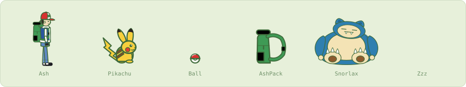

6 parts, as individual files

[`Ash`](art/parts/light/Ash.svg), [`Pikachu`](art/parts/light/Pikachu.svg), [`Ball`](art/parts/light/Ball.svg), [`AshPack`](art/parts/light/AshPack.svg), [`Snorlax`](art/parts/light/Snorlax.svg), [`Zzz`](art/parts/light/Zzz.svg)

Each part also exists in both themes: `art/parts/light/` and `art/parts/dark/`.

## Star Wars

Space mode. A very polite duel and the ship that arrives for it.

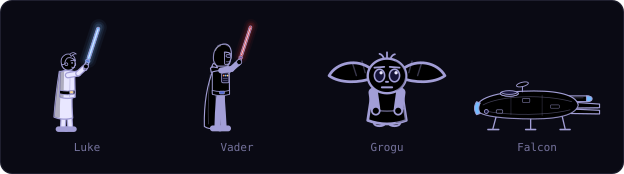

4 parts, as individual files

[`Luke`](art/parts/dark/Luke.svg), [`Vader`](art/parts/dark/Vader.svg), [`Grogu`](art/parts/dark/Grogu.svg), [`Falcon`](art/parts/dark/Falcon.svg)

Each part also exists in both themes: `art/parts/light/` and `art/parts/dark/`.

## Gravity Falls

Space mode. The cast of "Portal Under Pressure" and its woods.

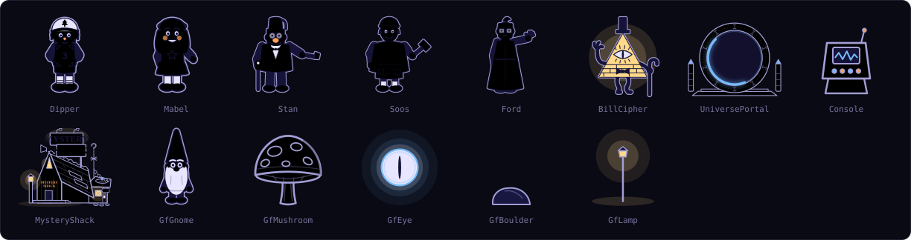

14 parts, as individual files

[`Dipper`](art/parts/dark/Dipper.svg), [`Mabel`](art/parts/dark/Mabel.svg), [`Stan`](art/parts/dark/Stan.svg), [`Soos`](art/parts/dark/Soos.svg), [`Ford`](art/parts/dark/Ford.svg), [`BillCipher`](art/parts/dark/BillCipher.svg), [`UniversePortal`](art/parts/dark/UniversePortal.svg), [`Console`](art/parts/dark/Console.svg), [`MysteryShack`](art/parts/dark/MysteryShack.svg), [`GfGnome`](art/parts/dark/GfGnome.svg), [`GfMushroom`](art/parts/dark/GfMushroom.svg), [`GfEye`](art/parts/dark/GfEye.svg), [`GfBoulder`](art/parts/dark/GfBoulder.svg), [`GfLamp`](art/parts/dark/GfLamp.svg)

Each part also exists in both themes: `art/parts/light/` and `art/parts/dark/`.

## Harry Potter

Space mode. A Seeker, an owl, a ferret and a very small, very fast ball.

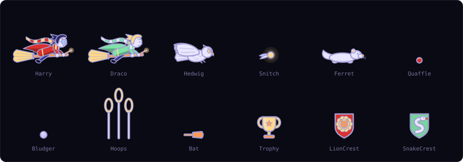

12 parts, as individual files

[`Harry`](art/parts/dark/Harry.svg), [`Draco`](art/parts/dark/Draco.svg), [`Hedwig`](art/parts/dark/Hedwig.svg), [`Snitch`](art/parts/dark/Snitch.svg), [`Ferret`](art/parts/dark/Ferret.svg), [`Quaffle`](art/parts/dark/Quaffle.svg), [`Bludger`](art/parts/dark/Bludger.svg), [`Hoops`](art/parts/dark/Hoops.svg), [`Bat`](art/parts/dark/Bat.svg), [`Trophy`](art/parts/dark/Trophy.svg), [`LionCrest`](art/parts/dark/LionCrest.svg), [`SnakeCrest`](art/parts/dark/SnakeCrest.svg)

Each part also exists in both themes: `art/parts/light/` and `art/parts/dark/`.

## Element marks

The four-emblem row on every hackathon card, in Nature (the four elements) and Space (the Star Wars factions).

**Nature mode (light)**

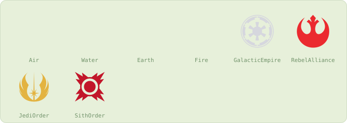

**Space mode (dark)**

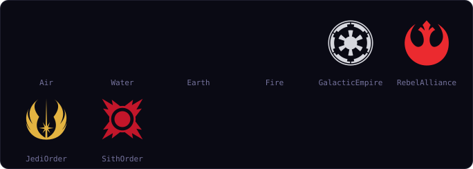

8 parts, as individual files

[`MarkAir`](art/parts/light/MarkAir.svg), [`MarkWater`](art/parts/light/MarkWater.svg), [`MarkEarth`](art/parts/light/MarkEarth.svg), [`MarkFire`](art/parts/light/MarkFire.svg), [`MarkGalacticEmpire`](art/parts/dark/MarkGalacticEmpire.svg), [`MarkRebelAlliance`](art/parts/dark/MarkRebelAlliance.svg), [`MarkJediOrder`](art/parts/dark/MarkJediOrder.svg), [`MarkSithOrder`](art/parts/dark/MarkSithOrder.svg)

Each part also exists in both themes: `art/parts/light/` and `art/parts/dark/`.

---

> **A note on the cast.** Fan tribute, strictly non-commercial. The characters belong to their creators and studios; the drawings are my own, made from scratch.
