# Scenes

*The art, in three pages:* [Characters](characters.md) · [Illustrations](illustrations.md) · **Scenes**

The compositions you meet while scrolling: the strips that head each section, the backdrops behind the pages, and the Contact scene. Each one is the real component, photographed in a browser with the site's own stylesheet, so the sky, the ground and the colours are exactly what a visitor sees. On the live site they move and the characters have opinions; here each holds the still frame that reduced-motion visitors get.

Strips are shown **with their sky** (the gradient the page paints behind them). Rebuild without it for transparent strips with `tools/build.sh scenes --no-bg`. The parts these are built from are in **[illustrations.md](illustrations.md)**; the people in them are in **[characters.md](characters.md)**.

**Jump to:** [Chapter 01: The Catch](#chapter-01-the-catch) · [Inspiration](#inspiration) · [Building Under Pressure](#building-under-pressure) · [Sports & Athleticism](#sports--athleticism) · [The journey strip](#the-journey-strip) · [The hero](#the-hero) · [The About backdrop](#the-about-backdrop) · [The project backdrop](#the-project-backdrop) · [The Contact scene](#the-contact-scene) · [The profile flight](#the-profile-flight) · [Cutaways](#cutaways)

## Chapter 01: The Catch

*Where:* About, Chapter 01 header. Nature: Ash walks up to a very large, very asleep Snorlax and throws the ball. Space: Harry chases the Snitch over a far-off Quidditch match.

**Nature mode (light)**

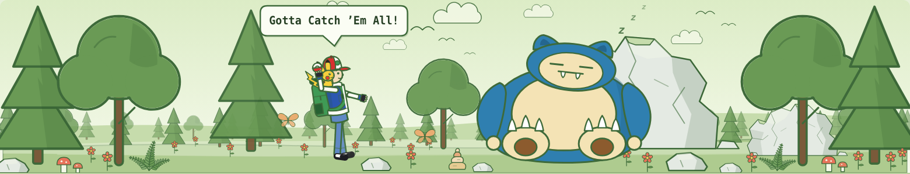

**Space mode (dark)**

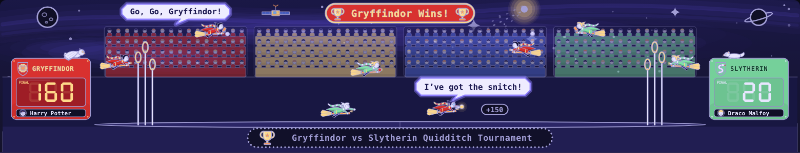

## Inspiration

*Where:* About, Inspiration section. Eight inspirations as eight stars, joined like a real asterism. Nature: fireflies over the hills. Space: a lunar ridge, a lander and a flag.

**Nature mode (light)**

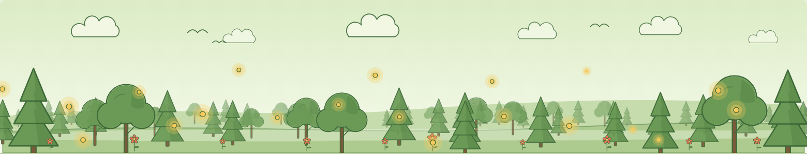

**Space mode (dark)**

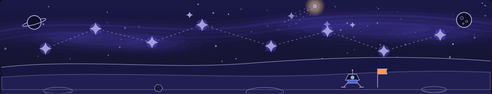

## Building Under Pressure

*Where:* About, Hackathons section; project pages (hackathon projects). The hackathon strip. Space is the "Portal Under Pressure" scene from Gravity Falls.

**Nature mode (light)**

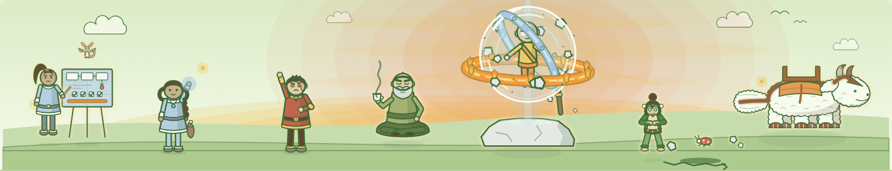

**Space mode (dark)**

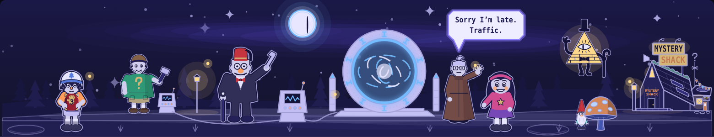

## Sports & Athleticism

*Where:* About, Sports section. Volleyball, a Taekwondo board break and a cricket shot that ends badly for the Sun (Nature) or the Moon (Space).

**Nature mode (light)**

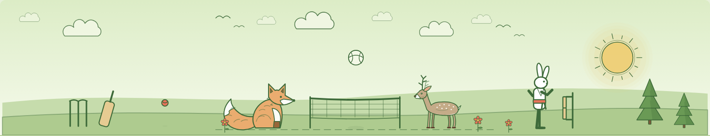

**Space mode (dark)**

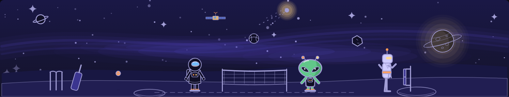

## The journey strip

*Where:* Home, Journey section. The Trail by day, the Trajectory by night.

**Nature mode (light)**

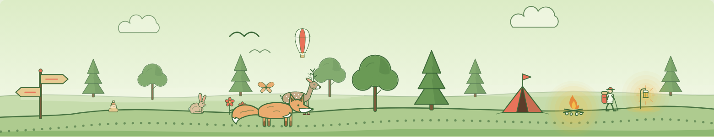

**Space mode (dark)**

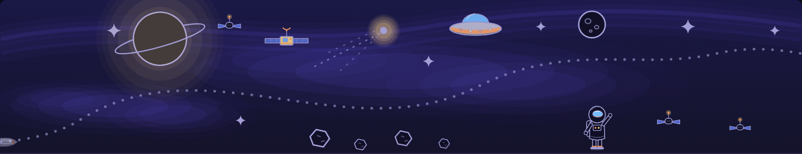

## The hero

*Where:* Home, top of the page. Nature: Aang on his rock, Appa flying into the sun, a summit with Toph. Space: the same ground, from launch pad to the far side of the moon.

**Nature mode (light)**

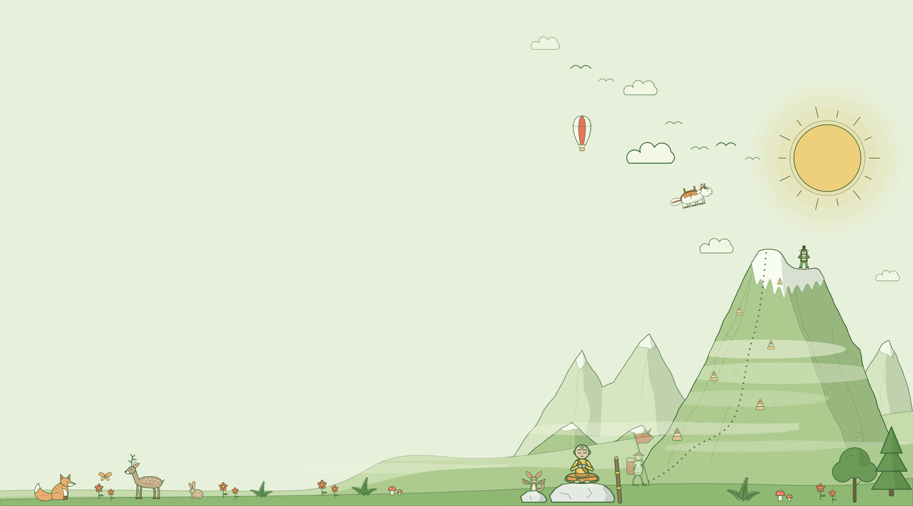

**Space mode (dark)**

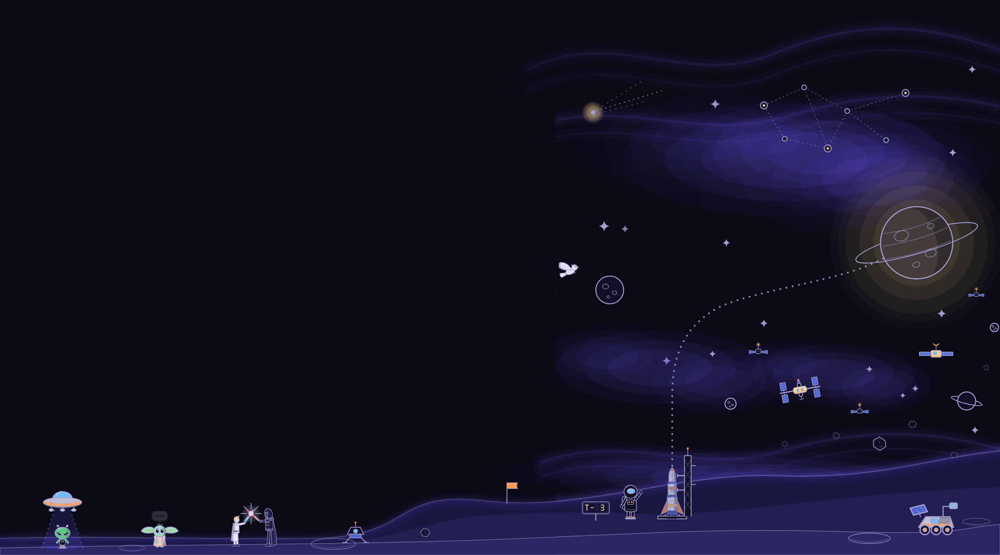

## The About backdrop

*Where:* About, top of the page. A top sky under the header, a ground band and the About focal scene.

**Nature mode (light)**

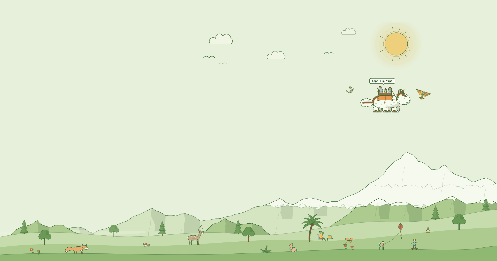

**Space mode (dark)**

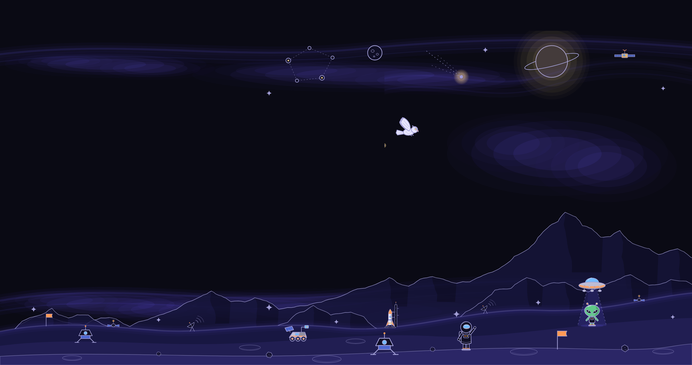

## The project backdrop

*Where:* Project pages, top of the page. A quiet sky and a short ground for the case-study pages.

**Nature mode (light)**

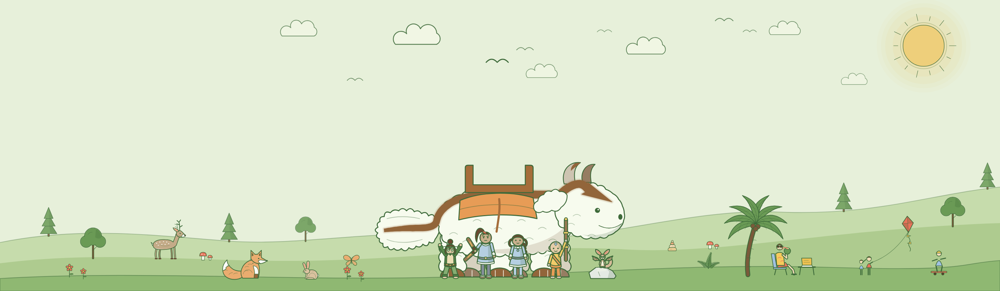

**Space mode (dark)**

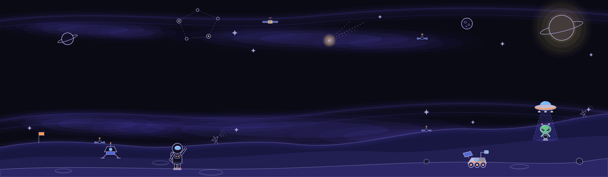

## The Contact scene

*Where:* Home and About, Contact section. Nature: the Avatar gang and the boomerang gag. Space: the lunar ground with the Star Wars duel on it.

**Nature mode (light)**

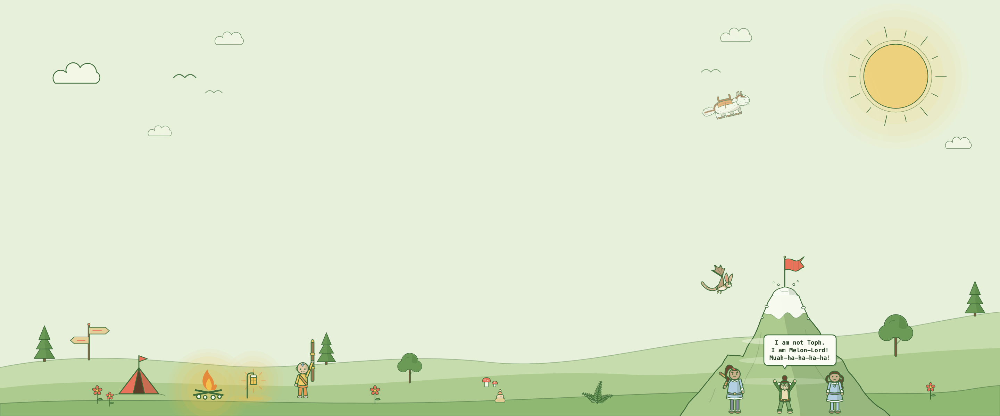

**Space mode (dark)**

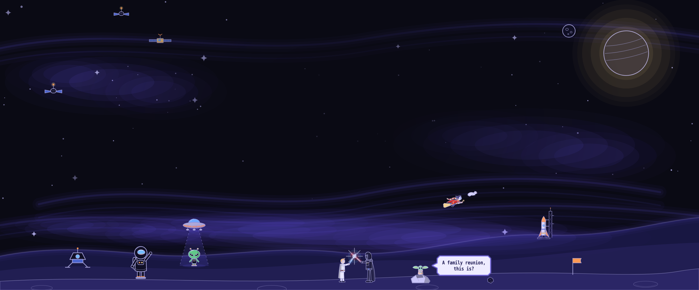

## The profile flight

*Where:* About, around the profile photo. Appa and Harry take turns crossing the profile photo.

**Nature mode (light)**

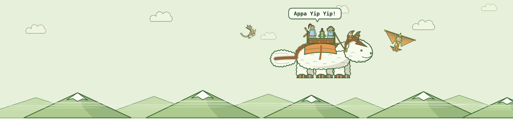

**Space mode (dark)**

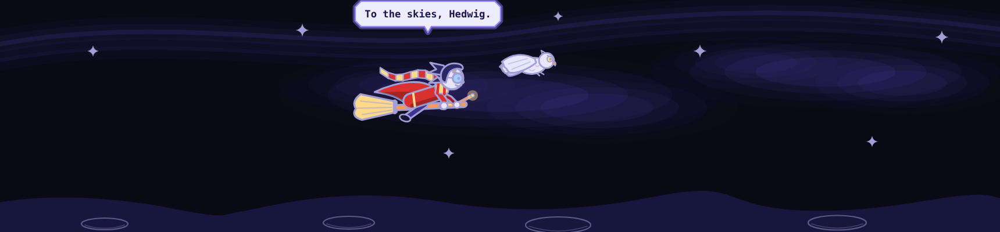

## Cutaways

Tight crops of the moving parts of a scene, so the characters can be seen up close. Drawn from the same components as the scenes, on a plain backdrop.

### The Avatar group portrait

*Where:* Appa flight scene (About, Contact, project header). Appa, Toph, Sokka, Katara and Aang, with Momo up in the saddle. Nobody is panicking.

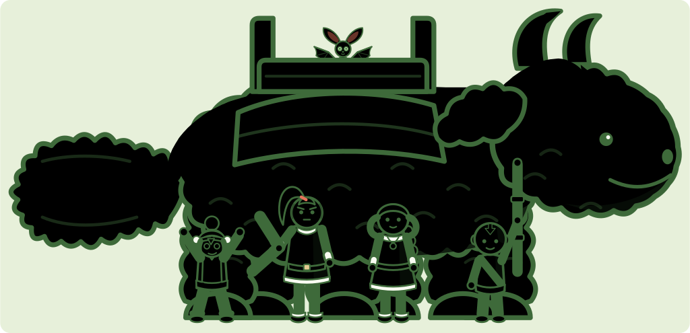

### Harry and Hedwig

*Where:* Space flight scene (hero, About profile). Same angle as Appa, different mode of transport.

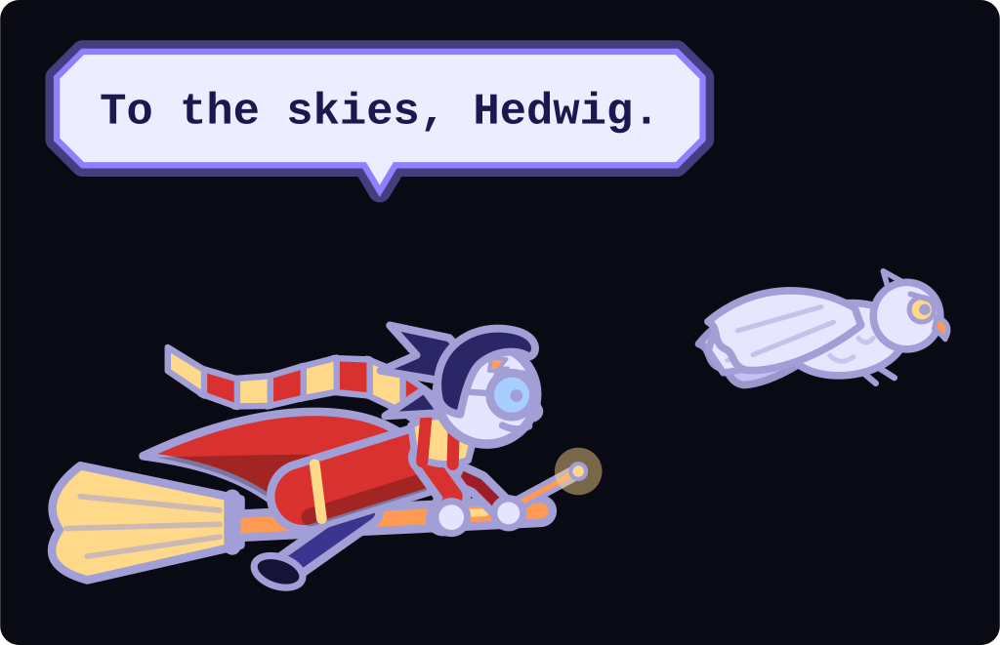

### The duel, paused

*Where:* Contact section (Space). Luke, Vader and Grogu in one calm frame. The real thing moves.

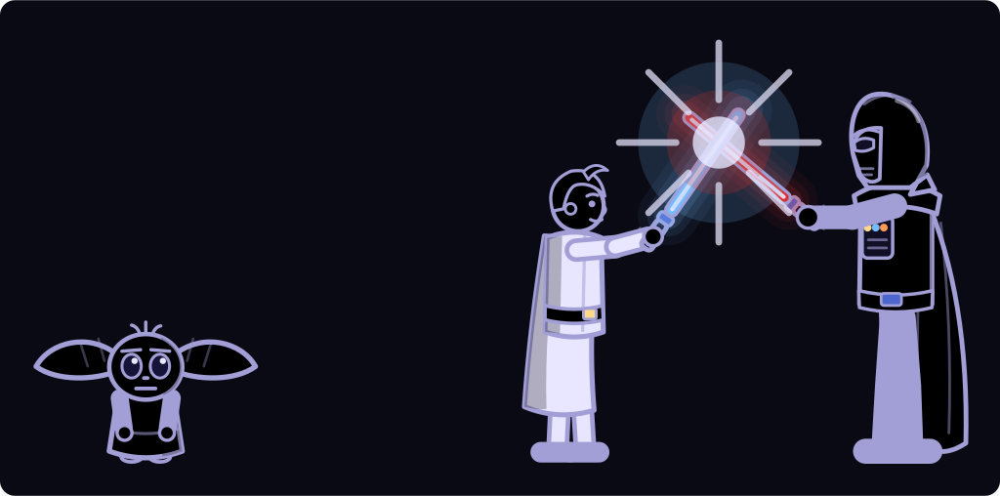

### The Space 404

*Where:* 404 page (Space). Wrong galaxy. Wrong school.

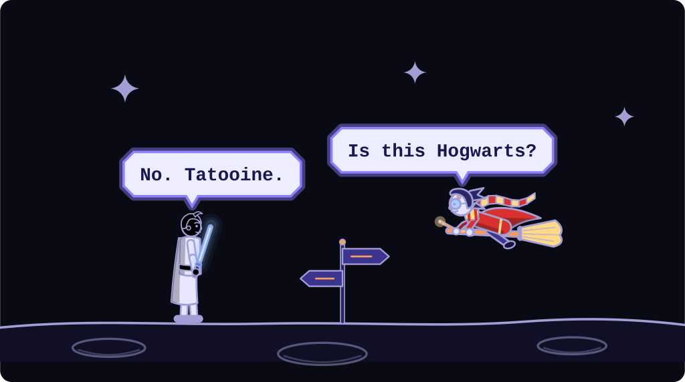

---

> **A note on the cast.** Fan tribute, strictly non-commercial. The characters belong to their creators and studios; the drawings are my own, made from scratch.
